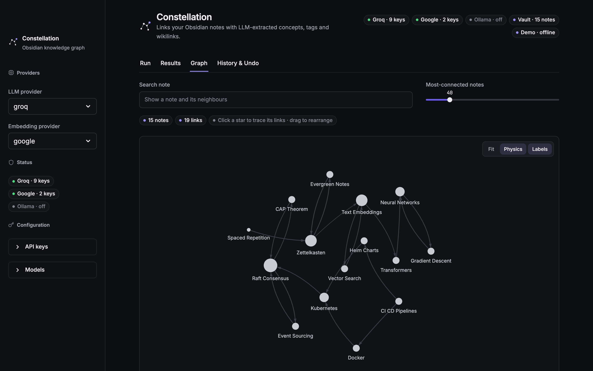
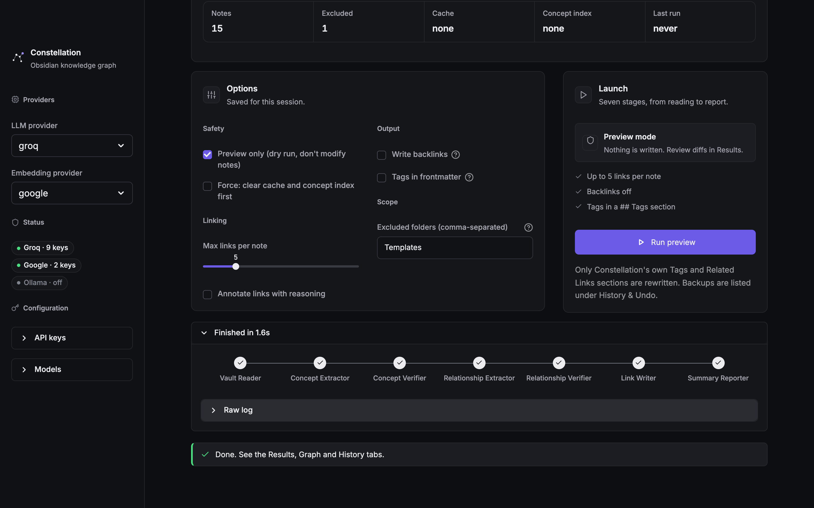
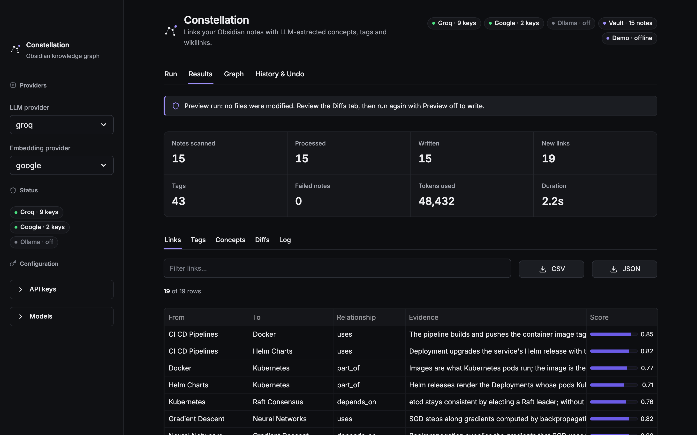
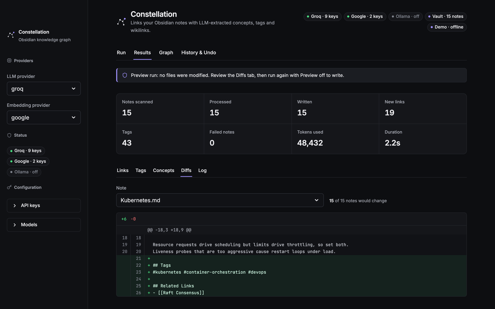
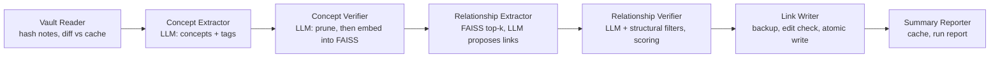

# Constellation

[](https://github.com/krxsh007/constellation/actions/workflows/ci.yml)

**Turns a folder of isolated Obsidian notes into a linked knowledge graph: an LLM pipeline extracts each note's concepts, finds the notes that are genuinely related, and writes tags and `[[wikilinks]]` back into your markdown, safely and incrementally.**



| Run | Results | Diff preview |
|---|---|---|
|  |  |  |

*Screenshots are from `constellation demo`, an offline run over the bundled [15-note example vault](examples/demo-vault/).*

## Try it in three commands

No API keys, no network: the demo runs the real pipeline with canned model responses.

```bash
git clone https://github.com/krxsh007/constellation && cd constellation
pip install -e .
constellation demo
```

That prints the run report, every tag and score-ranked link, and the diff it would apply to a note. `constellation demo --write` applies it to a temporary copy you can open in Obsidian. For the UI, run `streamlit run app.py` and click **Try the demo vault**.

## Two ways to use it

| | **Python app + CLI** (this repo's root) | **Obsidian plugin** ([`obsidian-plugin/`](obsidian-plugin/)) |
|---|---|---|
| For | Batch runs, scripting, watch mode, local Ollama | Staying inside Obsidian |
| Interface | Streamlit UI (Run · Results · Graph · History & Undo) and the `constellation` CLI | Side panel, commands, a preview modal with Apply/Cancel |
| Stack | Python, LangGraph, FAISS | TypeScript, no Python dependency |
| Vector search | FAISS index stored in the vault | JSON vectors + cosine in the plugin folder |

Both use the same prompts, the same two verification passes, the same link scoring and the same rules for which lines they may touch, so either can clean up after the other. [Plugin details ↓](#obsidian-plugin)

## Why it's interesting

- **Two-pass LLM verification.** Extraction is generous by design, so a second call prunes unsupported concepts and tags. Proposed links get the same treatment from a verifier whose only job is to reject weak ones. Deterministic filters then drop self-links, duplicates and links to notes that don't exist.
- **Content-hash incremental cache.** Each note is hashed without the sections the tool wrote, so re-runs cost tokens only for notes you actually edited. Failed notes are retried, and extraction is checkpointed so a crash later in the run doesn't waste it.
- **Score-ranked link caps.** Every link is scored by embedding similarity plus a bonus per independent supporting concept pair. When a note has more candidates than the cap, the strongest links win, not the alphabetically first.
- **Pickle-free FAISS.** The index lives inside a vault people sync and share, so it is stored as raw FAISS + JSON and never unpickled. An embedding manifest stops vectors from different models from being mixed.
- **Edit-safe writes.** Only lines the tool generated are ever replaced. Notes you edit mid-run are skipped, writes are atomic temp-file swaps, every run is backed up first and can be undone, and a lock allows one run per vault.
- **API key rotation.** Several free-tier keys are rotated on rate limits (compare-and-swap, so concurrent calls rotate once). Oversized requests are retried with smaller input, and malformed JSON is repaired.
- **Offline-tested pipeline.** 95 Python tests and 64 plugin tests run without network or keys, driving the real LangGraph graph end to end with fake LLM and embedding back-ends. CI also runs pyright, ruff, coverage and the demo.

The reasoning behind each of these, plus the alternatives rejected and the known limitations, is in **[docs/DESIGN.md](docs/DESIGN.md)**.

## How it works



1. **Vault Reader** (`nodes/io.py`) finds new or edited notes by content hash, skipping `.obsidian`, `.trash`, `.git` and excluded folders.
2. **Concept Extractor** (`nodes/concepts.py`) extracts structured concepts and 3–5 tags per note, concurrently.
3. **Concept Verifier** prunes them, checkpoints them to the cache, and re-embeds them into the vault-local FAISS index, dropping vectors for edited, renamed or deleted notes.
4. **Relationship Extractor** (`nodes/relations.py`) retrieves the nearest concepts from *other* notes and asks the LLM which are genuinely related, with evidence.
5. **Relationship Verifier** gets a second opinion, applies structural filters and scores the links.
6. **Link Writer** backs up, then rewrites only the generated sections of notes whose output changed, including notes that lost a link because its target disappeared.
7. **Summary Reporter** saves the cache and the run report.

What ends up in a note (or in the frontmatter `tags:` list with `--frontmatter-tags`):

```markdown
## Tags
#kubernetes #container-orchestration #devops

## Related Links
- [[Raft Consensus]] — etcd stays consistent by electing a Raft leader
- [[Docker]]
```

Only lines the tool generates (a run of hashtags, `- [[link]]` bullets) are ever replaced. The first line of your own prose, a heading or a code fence ends the section, and everything after it is left alone.

## Evaluation

Precision and recall of the generated links against a labelled vault, with ablations: see [eval/RESULTS.md](eval/RESULTS.md).

## Setup

Requires Python 3.11–3.13.

```bash
pip install -e .                   # or: pip install -r requirements.txt
pip install -e '.[ollama]'         # only for local mode
cp .env.example .env
```

**Providers.** What leaves your machine depends on the providers you choose:

- **Hosted (default):** note text goes to **Groq** for extraction, verification and relationships, and concept summaries go to **Google** for embeddings.
- **Local:** with `LLM_PROVIDER=ollama` and `EMBEDDING_PROVIDER=ollama`, everything runs against your own [Ollama](https://ollama.com) server and note content never leaves your machine. You can also mix the two.

```env
# Hosted: several keys of a type are rotated on rate limits
GROQ_API_KEY_1="gsk_..."
GROQ_API_KEY_2="gsk_..."
GOOGLE_API_KEY_1="AIza..."

# Local (after: ollama pull llama3.1:8b && ollama pull nomic-embed-text)
LLM_PROVIDER=ollama
EMBEDDING_PROVIDER=ollama
OLLAMA_BASE_URL=http://localhost:11434
OLLAMA_LLM_MODEL=llama3.1:8b
OLLAMA_EMBEDDING_MODEL=nomic-embed-text

# Optional
EXCLUDED_DIRS="Templates,Archive,Daily Notes"
MAX_LINKS_PER_NOTE=5
ANNOTATE_LINKS=false
BACKLINKS=false
TAGS_IN_FRONTMATTER=false
MAX_BACKUPS=10
```

Keys can also be pasted into the app's sidebar.

## Usage

```bash
streamlit run app.py                                     # UI
constellation /path/to/vault --dry-run                   # preview: writes nothing, prints the report
constellation /path/to/vault --exclude "Templates" --annotate
constellation /path/to/vault --llm-provider ollama --embedding-provider ollama --watch 30
constellation /path/to/vault --list-backups              # then --restore 20261017-153012 to undo
constellation /path/to/vault --strip                     # remove everything Constellation wrote
python3 scripts/monitor_keys.py                          # rate-limit headroom on every key
```

`constellation` is the same as `python3 main.py`.

<details>
<summary>All CLI flags</summary>

| Flag | Env var | What it does |
| --- | --- | --- |
| `--dry-run` / `-n` | | Runs everything but writes nothing; the result holds a before/after preview per note. |
| `--force` / `-f` | | Clears the cache and index so the whole vault is rebuilt. |
| `--max-links N` | `MAX_LINKS_PER_NOTE` | Caps the links per note (default 5); the highest-scoring links are kept. |
| `--annotate` | `ANNOTATE_LINKS` | Writes `- [[Target]] — reason`. |
| `--exclude "A,B"` | `EXCLUDED_DIRS` | Ignores folders such as `Templates/` or `Archive/`. |
| `--backlinks` | `BACKLINKS` | Also writes B → A for every A → B (same score, still capped). |
| `--frontmatter-tags` | `TAGS_IN_FRONTMATTER` | Puts tags in the frontmatter `tags:` list. Your own tags are kept; only the tool's tags are ever removed. |
| `--llm-provider groq\|ollama` | `LLM_PROVIDER` | Hosted Groq (default) or local Ollama. |
| `--embedding-provider google\|ollama` | `EMBEDDING_PROVIDER` | Hosted Google (default) or local Ollama. Switching rebuilds the index. |
| `--watch SECONDS` | | Re-runs whenever a note changes; its own writes are ignored. |
| `--strip` | | Removes all generated sections and tags (after a backup), then deletes the cache and index. |
| `--list-backups` / `--restore NAME` | `MAX_BACKUPS` | Lists or restores pre-write snapshots (newest 10 kept by default). |
| `demo [--write] [--dir PATH]` | | Offline run on the bundled example vault. |

</details>

Each run ends with a report:

```
Notes: 120 total, 4 processed, 0 failed, 6 written
Links: 212 total (+9 / -2)
LLM: 14 calls, 38211 in / 5120 out tokens | Embedding requests: 2
Duration: 41.3s
Backup: /path/to/vault/.constellation_backups/20261017-153012
```

<details>
<summary>Files it creates inside your vault</summary>

All of these can be deleted and will be rebuilt, except that deleting the backups loses your undo history.

- `.linker_cache.json`: hashes, concepts, scored links, tags, what was rendered last time, and the extraction checkpoint.
- `.linker_faiss_index/`: `index.faiss`, `docstore.json`, `manifest.json`. No pickle files are written or read.
- `.linker_report.json`: the report of the last real run.
- `.constellation_backups/<timestamp>/`: copies of the notes taken right before a run changed them.
- `.linker.lock`: present only while a run is in progress. A lock left by a dead process or older than 6 hours is treated as stale.

</details>

## Obsidian plugin

[`obsidian-plugin/`](obsidian-plugin/) is a TypeScript port of the pipeline that runs entirely inside Obsidian.

**Install manually:** run `cd obsidian-plugin && npm install && npm run build`, copy `main.js`, `manifest.json` and `styles.css` into `<vault>/.obsidian/plugins/constellation/`, then enable **Constellation** under Settings → Community plugins.

**Install with [BRAT](https://github.com/TfTHacker/obsidian42-brat):** add `krxsh007/constellation` once a GitHub release has `main.js`, `manifest.json` and `styles.css` attached. BRAT also reads a `manifest.json` from the repository root.

**Using it**
- The ribbon icon (✦) opens a side panel with the 7 stages running live, stats for the last run, and related notes for the open note.
- Commands: *Link entire vault*, *Link current note*, *Preview changes* (a per-note diff with Apply / Cancel), *Undo last run*, *Remove all Constellation output*.
- Settings: providers (Groq or Ollama, Gemini or Ollama), keys (one per line, rotated), models, link cap, annotations, backlinks, frontmatter tags, excluded folders, concurrency.

**How it differs from the Python app:** HTTP goes through Obsidian's `requestUrl` (no CORS issues). Vectors are L2-normalised and stored as JSON with cosine search instead of FAISS. Change detection hashes the note body, so frontmatter edits don't trigger re-extraction. Writes use `vault.process()` / `processFrontMatter`, and undo snapshots live in the plugin folder. A parity fixture generated from the Python code checks that both produce the same sections. The two tools keep separate caches. See [DESIGN.md](docs/DESIGN.md#the-obsidian-plugin-port) for the reasoning.

**Where data lives:** settings *and API keys* are stored in plain text in `.obsidian/plugins/constellation/data.json`. Exclude that file if you sync or publish your vault. The cache (`cache.json`), vector index (`index.json`) and undo snapshots (`backups/`) are in the same folder.

**Development:** `npm run dev` rebuilds on change, and `npm test` runs the vitest suite (pure logic plus offline end-to-end runs with a fake vault and fake providers).

## Development

```bash
pip install -e '.[dev]'           # ruff, pyright, pytest, pytest-cov
python3 -m unittest discover tests
ruff check . && ruff format --check . && pyright
pytest --cov                      # coverage report
```

CI runs all of these on Python 3.11–3.13, plus the offline demo and the plugin build and tests. Tagging `v*` attaches the sdist and wheel to a GitHub release. See [CONTRIBUTING.md](CONTRIBUTING.md) and [CHANGELOG.md](CHANGELOG.md).

## License

[MIT](LICENSE)
