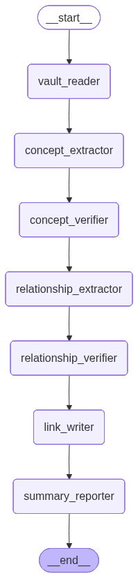

# Constellation

A local Streamlit app that organizes your Obsidian vault. Point it at a vault folder and it reads your markdown notes, extracts the core concepts with an LLM, then writes Obsidian tags and `[[wikilinks]]` back into the files — turning isolated notes into an interconnected constellation in your graph view.

The app, the cache and the vector index all live on your machine. What leaves it depends on the providers you pick:

- **Hosted mode (default)** — note text is sent to **Groq** for extraction, verification and relationship reasoning, and concept summaries are sent to **Google** for embeddings. Their data policies apply.
- **Local mode** — set `LLM_PROVIDER=ollama` and `EMBEDDING_PROVIDER=ollama` and everything runs against your own [Ollama](https://ollama.com) server. With both on Ollama (and `OLLAMA_BASE_URL` pointing at your machine), note content never leaves it.

You can also mix the two, e.g. a local LLM with Google embeddings.

## Pipeline Graph



## What it does

- **Concept extraction** — reads each note and pulls out its key ideas, technologies and entities.
- **Smart tagging** — appends 3–5 relevant hashtags (`#machine-learning`, `#devops`) under a `## Tags` heading, or into the YAML frontmatter `tags:` list.
- **Semantic cross-linking** — embeds every concept into a **local FAISS index** stored inside the vault, finds semantically related concepts in *other* notes, and writes `- [[Other Note]]` bullets under `## Related Links`.
- **Ranked links** — every link carries a score (FAISS similarity plus a bonus per supporting concept pair); when a note has more candidates than the cap, the strongest ones win.
- **Backlinks (optional)** — every link A → B can also be written as B → A.
- **Strict quality control** — a second LLM pass plus structural filtering rejects weak links, self-links, duplicates and links to notes that don't exist.
- **Cost-efficient caching** — hashes each note (ignoring the auto-generated sections) so re-runs only spend tokens on notes you actually changed. Notes whose extraction failed are retried on the next run, and extraction results are checkpointed so a crash later in the run doesn't waste them.
- **Safe writes** — every note is backed up before it is rewritten (undo with `--restore`), notes you edit while a run is in progress are left alone, and only one run can work on a vault at a time.
- **API key rotation** — supply several Groq/Google keys and it rotates through them with exponential backoff when it hits free-tier rate limits.
- **Preview mode** — run the whole pipeline and see exactly what it would write (before/after per note), without touching a single file.
- **Watch mode** — keep it running and it re-links whenever a note changes.
- **Run report** — LLM calls, tokens, embedding requests, links added/removed and failures for every run.

## Tech stack

- **Streamlit** — the local UI.
- **LangGraph / LangChain** — the 7-node pipeline (read → extract → verify → relate → verify → write → report).
- **Groq** or **Ollama** — inference for extraction, verification and relationship reasoning.
- **Google Generative AI** (`models/gemini-embedding-2`) or **Ollama** (`nomic-embed-text` by default) — concept embeddings.
- **FAISS** — local, on-disk vector index. No cloud database, no account needed.

## Setup

1. **Clone the repo** and activate your environment:
   ```bash
   conda activate langgraph
   ```
2. **Install dependencies:**
   ```bash
   pip install -r requirements.txt
   # Only for local mode:
   pip install langchain-ollama
   ```
3. **Configure** by copying the template file to `.env`:
   ```bash
   cp .env.example .env
   ```
   Hosted mode needs API keys. Multiple keys of the same type are rotated automatically:
   ```env
   # Groq (extraction, verification, relationships)
   GROQ_API_KEY_1="gsk_..."
   GROQ_API_KEY_2="gsk_..."

   # Google (embeddings)
   GOOGLE_API_KEY_1="AIza..."
   ```
   Local mode needs no keys — run `ollama serve`, pull the models, and point Constellation at them:
   ```bash
   ollama pull llama3.1:8b
   ollama pull nomic-embed-text
   ```
   ```env
   LLM_PROVIDER=ollama
   EMBEDDING_PROVIDER=ollama
   OLLAMA_BASE_URL=http://localhost:11434
   OLLAMA_LLM_MODEL=llama3.1:8b
   OLLAMA_EMBEDDING_MODEL=nomic-embed-text
   ```
   Other options (all optional):
   ```env
   EXCLUDED_DIRS="Templates,Archive,Daily Notes"
   MAX_LINKS_PER_NOTE=5
   ANNOTATE_LINKS=false
   BACKLINKS=false
   TAGS_IN_FRONTMATTER=false
   MAX_BACKUPS=10
   ```
   You can also paste keys straight into the app's sidebar instead of using `.env`.

## Usage

```bash
streamlit run app.py
```

Paste the full path to your vault (e.g. `C:\Users\saraf\Documents\VOID`), then hit **Run linker**. Progress streams live, and when it finishes you get tables of every link, tag and concept it produced.

Options available in the CLI (most are also in the UI):

| Flag | Env var | What it does |
| --- | --- | --- |
| `--dry-run` / `-n` | | Runs everything but writes nothing; the final state holds a before/after `preview` per note. |
| `--force` / `-f` | | Clears the cache and concept index so the whole vault is rebuilt from scratch. |
| `--max-links N` | `MAX_LINKS_PER_NOTE` | Caps the wikilinks written to any single note (default 5); the highest-scoring links are kept. |
| `--annotate` | `ANNOTATE_LINKS` | Appends reasoning to wikilinks (`- [[Target]] — reason`). |
| `--exclude "A,B"` | `EXCLUDED_DIRS` | Ignores folders such as `Templates/`, `Archive/`, `Daily Notes/`. |
| `--backlinks` | `BACKLINKS` | Also writes B → A for every link A → B (same evidence and score, still capped). |
| `--frontmatter-tags` | `TAGS_IN_FRONTMATTER` | Writes tags into the frontmatter `tags:` list (without `#`) instead of a `## Tags` section. Your own tags are kept; only tags Constellation added are ever removed. |
| `--llm-provider groq\|ollama` | `LLM_PROVIDER` | Hosted Groq (default) or a local Ollama model (`OLLAMA_LLM_MODEL`). |
| `--embedding-provider google\|ollama` | `EMBEDDING_PROVIDER` | Hosted Google (default) or local Ollama embeddings (`OLLAMA_EMBEDDING_MODEL`). Switching rebuilds the index automatically. |
| `--watch SECONDS` | | Runs, then polls the vault and re-runs whenever a note changes (its own writes are ignored). Ctrl+C to stop. |
| `--strip` | | Removes everything Constellation wrote (sections and its frontmatter tags) from every note, after a backup, then deletes the cache and index. Combine with `--dry-run` to just count. |
| `--list-backups` | | Lists the pre-write backups, newest first. |
| `--restore NAME` | | Copies the notes in backup `NAME` back into the vault (they are re-linked on the next run). |
| | `MAX_BACKUPS` | How many backups to keep (default 10). |

```bash
# Basic run
python3 main.py "C:/path/to/vault"

# Preview run with folder exclusions and annotated links
python3 main.py "C:/path/to/vault" --dry-run --annotate --exclude "Templates,Archive"

# Fully local, with backlinks, re-running on every change
python3 main.py "C:/path/to/vault" --llm-provider ollama --embedding-provider ollama --backlinks --watch 30

# Undo the last run
python3 main.py "C:/path/to/vault" --list-backups
python3 main.py "C:/path/to/vault" --restore 20261017-153012

# Remove everything Constellation ever wrote
python3 main.py "C:/path/to/vault" --strip

# Check rate-limit headroom on every key
python3 scripts/monitor_keys.py

# Run test suite
python3 -m unittest discover tests
```

After each run the CLI prints a compact report:

```
Notes: 120 total, 4 processed, 0 failed, 6 written
Links: 212 total (+9 / -2)
LLM: 14 calls, 38211 in / 5120 out tokens | Embedding requests: 2
Duration: 41.3s
Backup: /path/to/vault/.constellation_backups/20261017-153012
```

## How it works

1. **Vault Reader** (`nodes/io.py`) — scans for `.md` files (skipping `.obsidian`, `.trash`, `.git` and Constellation's own folders) in a stable sorted order and diffs them against `.linker_cache.json` to find new or edited notes.
2. **Concept Extractor** (`nodes/concepts.py`) — sends new notes to the LLM concurrently, extracting structured concepts and tags. Failures are recorded and retried next run.
3. **Concept Verifier** — cleans and de-duplicates the results, checkpoints them to the cache, then (in a worker thread, in batches) re-embeds them into `.linker_faiss_index`, dropping stale vectors for edited, renamed or deleted notes.
4. **Relationship Extractor** (`nodes/relations.py`) — queries the FAISS index for the most similar concepts in *other* notes and asks the LLM which are genuinely related.
5. **Relationship Verifier** — a second opinion, plus structural filtering (no self-links, no duplicates, no links to non-existent notes) and link scoring.
6. **Link Writer** (`nodes/io.py`) — backs up, then rewrites the `## Tags` and `## Related Links` sections of every note whose output changed (including notes that lost a link because its target was deleted or renamed) via a temp-file swap. A note edited since it was read is skipped.
7. **Summary Reporter** — saves the cache and the run report so the next run is cheap.

## What it writes to your notes

It appends (and thereafter maintains) two sections at the end of a note:

```markdown
## Tags
#containerization #devops

## Related Links
- [[Docker]] — Container runtime and deployment platform
- [[Kubernetes Orchestration]]
```

With `TAGS_IN_FRONTMATTER=true` the tags go into the frontmatter instead, merged with your own:

```markdown
---
tags:
  - my-own-tag
  - containerization
  - devops
---
```

Only lines the tool itself generated — a run of hashtags, or `- [[link]]` bullets (with or without reasoning annotations) — are ever replaced. As soon as it hits anything else (your prose, a heading, a code fence) it stops and leaves the rest of the file alone, so notes you keep editing by hand are safe. `tests/test_notes.py` covers this.

## Files it creates inside your vault

All of these are safe to delete (they'll be rebuilt), except that deleting backups removes your undo history:

- `.linker_cache.json` — file hashes, concepts, scored links, tags, the link sets and frontmatter tags written last time, and a checkpoint of extraction results.
- `.linker_faiss_index/` — the local vector index: `index.faiss` (vectors), `docstore.json` (concept text/metadata) and `manifest.json` (embedding provider, model and dimension). No pickle files are written or loaded; an index built with a different embedding model, or an old pickle-based index, is discarded and rebuilt from the cache.
- `.linker_report.json` — the report of the last real run.
- `.constellation_backups/<YYYYmmdd-HHMMSS>/` — copies of the notes taken right before each run modified them (newest `MAX_BACKUPS` kept).
- `.linker.lock` — present only while a run is in progress (holds the pid and start time). A lock whose process is gone or that is older than 6 hours is treated as stale.

## License

This project is licensed under the [MIT License](LICENSE).
